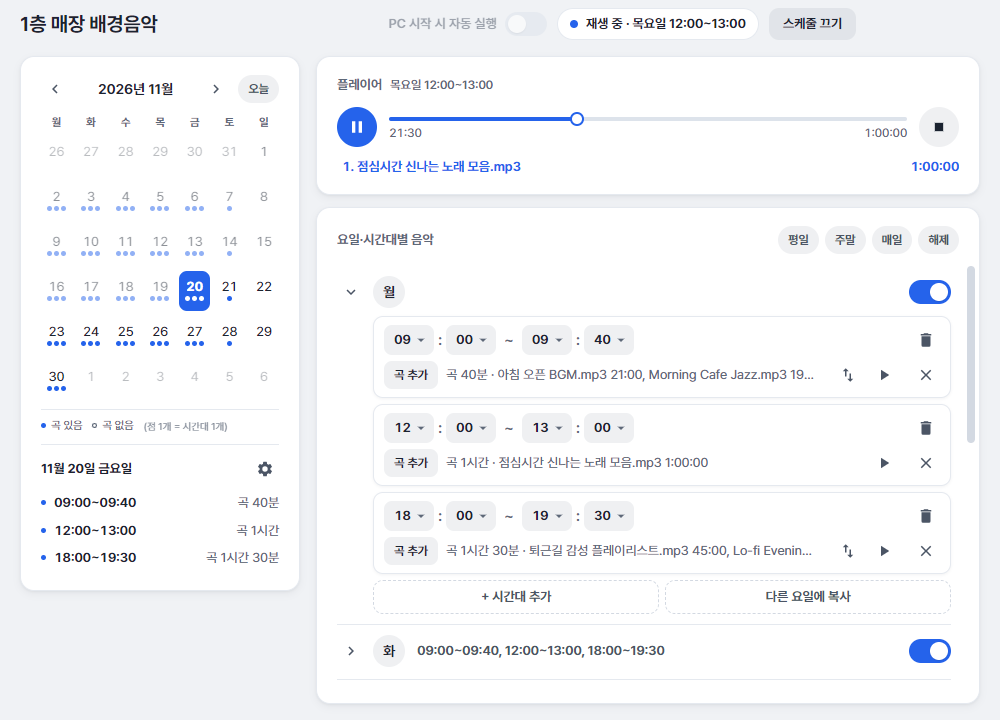
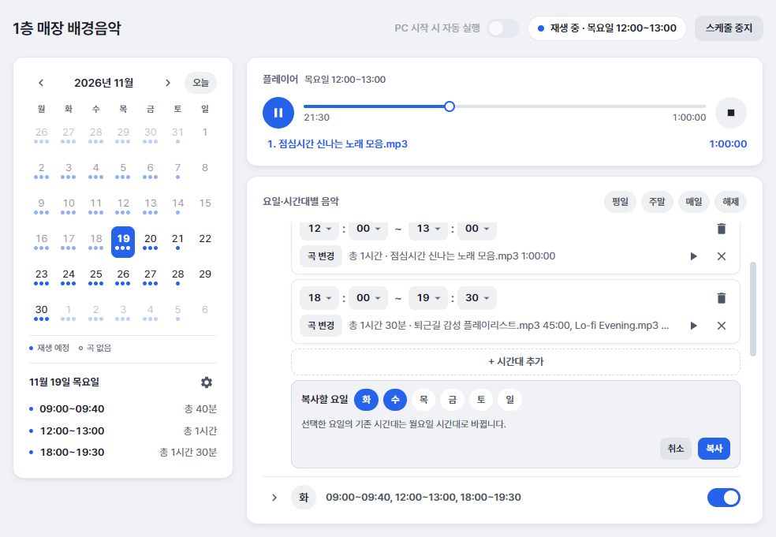
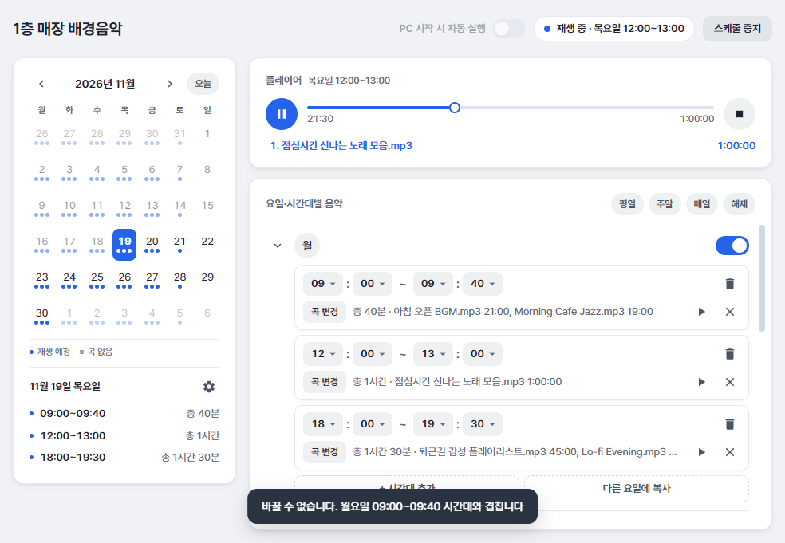

# 스케줄 플레이어

요일·시간대별로 정해진 음악을 자동 재생하는 Windows 데스크톱 앱입니다. 매장 배경음악처럼 정해진 시간에 음악을 틀고 끄는 용도로 만들었습니다. Electron으로 만들었고, 설치 파일(exe) 하나로 다른 PC에 배포할 수 있습니다.



## 화면

| 다른 요일에 복사 | 시간 검사 |
|---|---|
|  |  |
| 한 요일의 시간대와 곡을 고른 요일들에 한 번에 복사합니다. 복사받은 요일은 접혀서 한 줄로 보입니다. | 다른 시간대와 겹치게 바꾸면 원래 시간으로 되돌리고 이유를 알려줍니다. |

- **왼쪽 달력**: 스케줄이 잡힌 날짜에 점이 찍힙니다. 날짜를 누르면 아래에 그날의 시간대와 총 곡 시간이 나오고, 톱니바퀴로 그 요일 설정으로 이동합니다.
- **플레이어**: 지금 불러온 시간대와 곡 목록, 곡별 길이를 보여줍니다.
- **상단**: 스케줄 상태(점 색: 회색 꺼짐 · 초록 대기 · 파랑 재생 중)와 시작/중지, PC 시작 시 자동 실행 스위치가 있습니다.

## 주요 기능

- **요일·시간대별 음악**
  - 요일마다 시간대를 여러 개 만들 수 있습니다.
  - 시간대마다 시작~종료 시간과 재생 목록(여러 곡)을 따로 정합니다.
  - 평일·주말·매일·해제 버튼으로 요일을 한 번에 켜고 끕니다.
  - **다른 요일에 복사**: 한 요일의 시간대와 곡을 고른 요일들에 한 번에 복사합니다.
  - **요일 접기**: 요일 앞 화살표로 접으면 시간대가 한 줄로 요약됩니다. 접은 상태는 저장됩니다.
- **곡 관리**
  - 시간대에 곡이 없으면 **곡 선택**, 있으면 **곡 추가**로 지금 곡 뒤에 이어 붙입니다. 파일 선택 창에서 여러 곡을 한 번에 고를 수 있습니다.
  - 곡이 2개 이상이면 **곡 순서(⇅)** 버튼으로 목록을 펼쳐 위·아래로 옮기거나 한 곡씩 뺄 수 있습니다.
  - 시간대마다 곡 총 길이("곡 2시간 42분")와 곡별 길이를 보여줍니다. 시간대 길이가 아니라 곡 길이의 합입니다.
  - **곡 길이에 맞춤** 버튼으로 종료 시간을 "시작 + 총 곡 시간"으로 맞춥니다.
- **재생할 수 없는 파일**
  - 곡을 넣을 때 한 번씩 열어보고, 음악 파일이 아니거나 손상·지원하지 않는 형식·0초인 파일은 넣지 않고 알려줍니다.
  - 넣은 뒤에 파일이 없어지면 `(파일 없음)`, 읽을 수 없게 되면 `(재생 불가)`로 표시하고 재생에서 건너뜁니다.
  - 재생 중 오류가 나면 다음 곡으로 넘어가고, 재생할 곡이 하나도 없으면 멈추고 화면과 Windows 알림으로 알립니다.
- **자동 재생**
  - 시작 시각에 그 시간대 목록을 첫 곡부터 재생합니다.
  - 목록이 끝나도 종료 시각까지 반복하고, 종료 시각에 멈춥니다.
  - 종료가 시작보다 빠르면 다음 날로 넘어가는 시간대로 봅니다. 예: 23:00~01:00
- **스케줄 켤 때 즉시 재생**
  - 지금이 곡이 있는 시간대 안이면 바로 재생합니다.
  - 시간대 밖이면 다음 재생 시각을 안내합니다.
- **시간 검사**
  - 시간대가 겹치는 설정은 막습니다. 시작과 종료가 같은 설정도 막습니다.
  - 시간 변경, 시간대 추가, 요일 켜기, 평일·주말·매일 버튼, 다른 요일에 복사, 곡 길이에 맞춤 모두에 적용됩니다.
- **달력**
  - 스케줄이 잡힌 날짜에 시간대 수만큼 점(최대 3개)을 찍어, 요일 반복이 맞는지 확인할 수 있습니다. 채운 점은 재생할 시간대, 빈 점은 곡 없는 시간대입니다. 다른 달 날짜에는 점을 찍지 않습니다.
  - 날짜를 누르면 그날의 시간대가 나옵니다.
- **플레이어**
  - 미리듣기, 재생/일시정지, 정지, 진행 막대, 재생 목록 표시가 있습니다.
- **상단 상태 표시**
  - 꺼짐·대기 중·재생 중·재생할 시간대 없음 상태와 다음 재생 시각을 보여줍니다.
  - 스케줄 켜기/끄기 버튼도 여기 있습니다. 정해진 시각의 자동 재생 전체를 켜고 끄는 버튼이고, 지금 곡만 멈추려면 플레이어의 ■를 씁니다.
- **PC 시작 시 자동 실행**
  - Windows 로그인 때 창 없이 트레이에서 실행됩니다.
  - 지난번에 켜둔 스케줄은 그대로 다시 켜집니다.
- **창 닫기와 종료**
  - 창을 닫으면(X) "트레이로 숨기기 / 종료 / 취소"를 묻습니다. "다시 묻지 않기"로 고정할 수 있고, 트레이 메뉴의 "창을 닫으면"에서 다시 바꿉니다.
  - PC 시작 시 자동 실행으로 켜진 경우에는 묻지 않고 트레이로 숨깁니다.
  - 종료는 트레이 메뉴 "종료" 또는 `Ctrl+Q`. 스케줄이 켜져 있으면 한 번 더 확인합니다.
  - 트레이 메뉴에서 열기, 자동 실행 켜기/끄기도 할 수 있습니다.
- **기타**
  - 타이틀은 눌러서 바로 수정할 수 있습니다.
  - 스케줄 재생이 시작되면 Windows 알림이 뜹니다.
  - 앱은 하나만 실행됩니다.

## 폴더 구조

```
schedule-music-app/
├─ main.js              Electron 메인 프로세스: 창, 트레이, 자동 실행, 자동재생 허용
├─ index.html           화면 구조
├─ render.js            화면 동작: 스케줄 저장·검사·재생, 달력, 플레이어
├─ style.css            스타일 (Panther 라이트 팔레트)
├─ assets/
│  ├─ icon.svg          앱 아이콘 원본
│  ├─ icon.png          창 아이콘 (256px)
│  └─ tray.png, tray@2x.png   트레이 아이콘 (16px, 32px)
├─ build/
│  ├─ icon.ico          exe·설치 파일 아이콘
│  └─ icon.png          512px 아이콘
├─ scripts/
│  ├─ make-icon.js      icon.svg → png·ico 생성
│  └─ copy-release.js   빌드한 설치 파일을 releases/로 복사
├─ docs/screenshots/    README 화면 캡처 (설치 파일에는 들어가지 않음)
├─ 설치안내.md / 설치안내.txt   다른 PC 설치 안내 (사용자용)
├─ dist/                빌드 결과 (빌드할 때마다 바뀜, git 제외)
└─ releases/            배포한 설치 파일을 버전별로 보관 (git 제외)
```

## 개발

필요한 것: Node.js (18 이상 권장)

```powershell
npm install
npm start
```

- `npm start`로 실행하면 파일을 저장할 때마다 자동으로 다시 불러옵니다(electron-reload).
- 개발 실행에서는 "PC 시작 시 자동 실행" 스위치가 꺼진 채로 흐리게 보입니다. 자동 실행은 설치한 exe에서만 쓸 수 있습니다. 개발 중에 켜면 `electron.exe` 자체가 시작프로그램에 등록되기 때문입니다.

## 빌드 (설치 파일 만들기)

배포할 버전은 `release`로 빌드합니다. 빌드한 뒤 설치 파일을 `releases\`에 버전별로 복사해 둡니다.

```powershell
npm run release
```

- 결과: `releases\schedule-music-app Setup <버전>.exe` (지금은 1.0.0, 1.1.0, 1.2.0 보관 중)
- 확인용으로 빌드만 하려면 `npm run build`를 씁니다. 결과는 `dist\`에만 생깁니다.
- 새 버전을 낼 때는 먼저 `package.json`의 `version`을 올립니다. 같은 버전으로 다시 만들면 `releases\`의 같은 파일이 바뀝니다.
- `releases\`는 설치 파일이 커서(약 76MB) git에 올리지 않고 이 PC에만 보관합니다.
- NSIS 원클릭 설치 파일입니다. 사용자 계정 단위로 설치되고, 관리자 권한은 필요 없습니다.
- 코드 서명이 없어서, 처음 실행할 때 Windows SmartScreen 경고가 뜹니다.

## 아이콘 바꾸기

`assets/icon.svg`를 수정한 뒤 아래 명령을 실행합니다. 그다음 다시 빌드하면 됩니다.

```powershell
npm run icon
```

## 데이터 저장

모든 설정은 화면 쪽 `localStorage`에 저장됩니다. 위치는 `%APPDATA%\schedule-music-app`입니다.

| 키 | 내용 |
|---|---|
| `schedule-player-days` | 요일별 켜짐, 시간대(시작·종료), 곡 목록(파일 이름·경로) |
| `schedule-player-on` | 스케줄을 켜둔 상태 (다음 실행 때 자동으로 다시 켬) |
| `schedule-player-title` | 바꾼 타이틀 |
| `schedule-player-folded` | 접어둔 요일 |

곡 목록에는 파일 이름·경로와 함께 곡 길이(초)도 저장됩니다. 처음 한 번 파일에서 읽고, 이후에는 저장된 값을 씁니다.

창을 닫을 때의 동작(물어보기 / 트레이로 숨기기 / 종료)은 메인 프로세스가 같은 폴더의 `window-settings.json`에 저장합니다.

- 음악 파일은 복사하지 않고 **경로만 저장**합니다. 파일을 옮기거나 지우면 재생되지 않습니다.
- 예전 형식(요일당 시간 하나)으로 저장된 설정은 읽을 때 시간대 하나로 바뀝니다.

## 동작 메모

- 창이 760px보다 넓으면 페이지 전체는 스크롤되지 않습니다. 헤더·달력·플레이어는 그대로 두고 요일 목록만 카드 안에서 스크롤됩니다. 좁으면 한 줄로 쌓이고 페이지가 스크롤됩니다.
- 스케줄은 1초마다 현재 요일·시각을 확인합니다.
  - 창이 숨겨져 있어도 늦어지지 않도록 `backgroundThrottling: false`로 설정했습니다.
- 클릭 없이도 재생되도록 `autoplay-policy=no-user-gesture-required` 스위치를 씁니다.
- 자동 실행은 `app.setLoginItemSettings`로 Windows 시작프로그램에 `--autostart` 인자와 함께 등록합니다.
  - 이 인자로 실행되면 창을 띄우지 않고 트레이에서 시작합니다.
- 화면 코드가 Node 기능을 바로 쓰도록 `nodeIntegration: true`, `contextIsolation: false`로 되어 있습니다.
  - 로컬 파일만 여는 앱이라 이렇게 두었습니다.
  - 외부 웹 콘텐츠를 불러오게 바꾼다면 preload 방식으로 바꾸는 게 안전합니다.

## 사용 시 주의 (요약)

자세한 내용은 [설치안내.md](설치안내.md)에 있습니다.

- 자동 실행은 PC 전원을 켰을 때가 아니라 **Windows 로그인 시** 실행됩니다. 무인 PC는 자동 로그인을 설정하세요.
- 절전 모드 중에는 재생되지 않습니다. 절전 모드를 꺼두세요.
- PC 시계가 정확해야 합니다. 시간 자동 설정을 켜두세요.
- 창을 닫을 때 **트레이로 숨기기**를 고르면 스케줄이 계속 돕니다. 완전히 끄려면 트레이 메뉴 **종료** 또는 `Ctrl+Q`.
